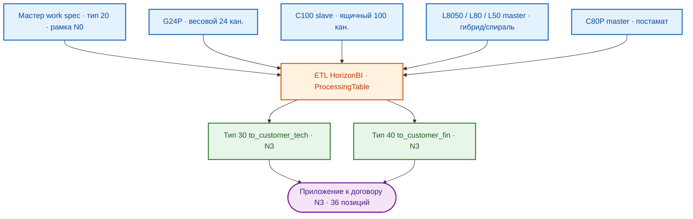

# ПРОЕКТ 8/2026-N3-ГОРИЗОНТ: ПРОМЫШЛЕННЫЕ ВЕНДИНГОВЫЕ АППАРАТЫ WATE TECHNOLOGY — РЕВЕРС-ИНЖИНИРИНГ И АДАПТАЦИЯ ПТК «HORIZON VM»
**Прикладной заказ №3 рамочного договора 8/2026-N0-ГОРИЗОНТ · ООО «ГОРИЗОНТ» (ГК «ПЕРЕДОВЫЕ РЕШЕНИЯ») → ООО «ТМ ТЕХНОЛОГИЯ»**
(заказчик — новое юрлицо ГК заказчика, с 20.10.2026; ранее — ООО «Точные машины»)

> ⚠️ **Важно:** документ — **строго для внутреннего пользования**. Передача
> сотрудникам вне проектной команды и любые внешние копии запрещены: содержит
> внутренние бизнес-процессы, коммерческие механики и статусы переговоров.

---

## ОГЛАВЛЕНИЕ

1. [Введение](#1-введение)
2. [Обзор заказа](#2-обзор-заказа)
3. [Структура ИРП](#3-структура-ирп)
4. [Система спецификаций](#4-система-спецификаций)
5. [Бизнес-механика сделки](#5-бизнес-механика-сделки)
6. [Структура документации проекта](#6-структура-документации-проекта)
7. [Дорожная карта и статус](#7-дорожная-карта-и-статус)
8. [Технологический стек · контакты и реквизиты](#8-технологический-стек--контакты-и-реквизиты)

---

## 1. ВВЕДЕНИЕ

Заказ `8/2026-N3-ГОРИЗОНТ` — третий прикладной заказ рамочного договора
`8/2026-N0-ГОРИЗОНТ` (подписан исполнителем 20.10.2026 через ЭДО). Предмет:
реверс-инжиниринг группы аппаратов производителя **Wate technology** и адаптация
собственной ПТК **«Horizon VM»** для ряда моделей (постаматные, спиральные,
гибридные, весовые, ящичные). Результат — полнофункциональные прототипы
**6 моделей** (итоговый перечень зафиксирован Решением №2 заказчика от 19.10.2026).

Заказчик с 20.10.2026 — **ООО «ТМ ТЕХНОЛОГИЯ»** (ГК заказчика; все заказы
рамки N1–N7 выполняются для него). Прежняя переписка и преддоговорные решения
велись с ООО «Точные машины» того же контура — история не переписывается,
новые документы выпускаются на новое лицо. Подписание N1/N2/N3 — **одновременное**,
через ЭДО.

## 2. ОБЗОР ЗАКАЗА



### 2.1. Состав моделей (6 VM по Решению №2)

| № | Модель | Тип |
| :--: | :--- | :--- |
| 1 | WATE G24P | Smart Weighing and Outlet Line Edge Warehouse (весовой, 24 кан.) |
| 2 | WATE C100 (slave) | Smart Drawer Line-side Warehouse (ящичный, 100 кан., вспомогательный) |
| 3 | WATE L8050/master | Гибридный (спираль/постамат) |
| 4 | WATE L80/master | Спиральный |
| 5 | WATE L50/master | Спиральный |
| 6 | WATE C80P/master | Постаматный |

Выведены: `L8050 stand-alone` (→ `G24P`), `C80/master` (→ `C100 (slave)`),
`C80/slave` (без замены). G24P остаётся в N3, перспектива — выделенный заказ.

### 2.2. Экономика и срок

| Параметр | Значение |
| :--- | ---: |
| Позиции спецификации | 36 (6 блоков модели × 6 позиций) |
| Стоимость, без НДС | 19 345 800,00 ₽ |
| НДС 22% | 4 256 076,00 ₽ |
| Стоимость с НДС | 23 601 876,00 ₽ |
| Срок выполнения | 210 к.д. |
| Блок G24P | 3 600 000,00 ₽ без НДС (прочие блоки — базовые) |

## 3. СТРУКТУРА ИРП

```text
8_2026-N3-Горизонт\
  01__Документация\        акты, сверки, переписка, протоколы
  02__Спецификации\
    01__Заказы\            исходный заказ №3 (docx; редакция до Решения №2 — «7 VM»)
    02__Спецификации\      30__to_customer_tech\ · 40__to_customer_fin\ (ждут перегенерации)
    03__ТКП\02__Участники\ Спецификация №3 на ООО «ТМ ТЕХНОЛОГИЯ» (nosign.pdf, raw docx)
  03__Проект\              00__raw\ (вспомогательные данные), 03__План-график\ (формируется),
                           журнал ai-8_2026-n3-горизонт.md
  04__Договор\             согласование → согласованный → подписанный (пакет ЭДО)
  05__Счета\               счета по «Варианту D»
  06__Затраты\ · 07__Логистика\
  08__Закрывающие документы\ · 09__Подписанные документы\ · 10__Персонал\
```

Рамка `..\8_2026-N0-Горизонт\` — мастер-данные (`20__work_spec`), преддоговорные
документы (отчёт 02.10.2026, Решения №1/№2), рамочный договор, реестр сверки
v01↔v02.

## 4. СИСТЕМА СПЕЦИФИКАЦИЙ

| Тип | Каталог | Назначение |
| :---: | :--- | :--- |
| 20 | `..\8_2026-N0-Горизонт\02__Спецификации\02__Спецификации\20__work_spec\` | мастер-данные (единственная точка истины; корректирует сторона лично; агент — только чтение) |
| 30 | `02__Спецификации\02__Спецификации\30__to_customer_tech\` | техническое приложение к договору, без цен |
| 40 | `02__Спецификации\02__Спецификации\40__to_customer_fin\` | коммерческое приложение: цены реализации, НДС 22%, чистая база |

**→ Регламент системы спецификаций**: [AGENTS.md](./AGENTS.md) § 3.
Ключ позиции — `HASH COLLECTION`; в выходные документы попадают только
`isSHIPPED = "true"` и старшая `VER COLLECTION`. Нумерация макроблоков `3.x`
по новому составу — рекомендуемая раскладка (`3.1` → G24P, `3.5` → C100 slave),
сверять по мастеру. Запрещено раскрытие во внешних документах: `SUPPLIER`,
закупочные цены, артикулы, наценки, скидки, `COMMENT WORK`.

## 5. БИЗНЕС-МЕХАНИКА СДЕЛКИ

- **Авансовая механика «Вариант D»** (схема 6.3.2, согласована): авансы 1–2
  (по 6 710 000,00 ₽ с НДС, на 30/60-й к.д.; первый платёж с отсрочкой 1 месяц)
  запускают закупки двух половин заказа (~50/50 по объёму), аванс 3 (7 376 120,00 ₽,
  90-й к.д.) — продолжение работ/доукомплектование;
- **Консалтинг выездной приёмки** (аванс 4 — 243 756,00 ₽ с НДС, счёт за 14 к.д.
  до приёмки): совместная с заказчиком приёмка ТМЦ у `Wate technology`, встроен
  в каждый блок позицией `3.x04.1` (33 300 × 6 = 199 800,00 ₽ без НДС) — закрывает
  риск брака на приёмке;
- **Постоплата 2 562 000,00 ₽ с НДС** (испытания, позиции `3.x03.1`) —
  процентование по каждому экземпляру аппарата: исполнитель подаёт акт выполненных
  работ и запрос на частичное закрытие (позиция = экземпляр, не строка спецификации);
- **Техмитап с WATE** (10–15 вопросов от исполнителя) вместо отменённого аудита
  на заводе; сроки увязываются с совместной выездной приёмкой;
- **Перспектива цепочки:** N3 — источник наработок для **N6** (КД+металл+монтаж
  парка Wate, триггер ← 70–80% выполнения N3) и **N7** (исполнительная/эксплуатационная
  документация парка, триггер ← 70–80% N6); G24P — кандидат выделенного заказа.

## 6. СТРУКТУРА ДОКУМЕНТАЦИИ ПРОЕКТА

### Для пользователей:
- 📘 [Манифест AGENTS.md](./AGENTS.md)
- 📑 [Спецификация №3 на ООО «ТМ ТЕХНОЛОГИЯ» (nosign, pdf)](./02__Спецификации/03__ТКП/02__Участники/Спецификация-№%203%20-%20ТМ%20Технология%20%2308_2026-n3-горизонт%20nosign.pdf)
- 📄 [Исходный заказ №3 (редакция до Решения №2 — «7 VM»)](./02__Спецификации/01__Заказы/Заказ-%E2%84%96%203-%20Точные%20машины%20-%207%20VM%20%238_2026-n3-горизонт.docx)
- 🤝 Решение №2 заказчика (19.10.2026, состав 6 моделей) — в рамке:
  `..\8_2026-N0-Горизонт\01__Документация\Протоколы\01__преддоговорные переговоры\03__Решение-N2 - преддоговорные переговоры - 19.10.2026.md`

### Для команды:
- 🔧 Техническое приложение, тип 30: [30__to_customer_tech](./02__Спецификации/02__Спецификации/30__to_customer_tech/30__Спецификация-Точные%20машины%20-%20заказ%203%20-%20to%20customer%20tech%20%238_2026-n3-горизонт.xlsx) — действует до перегенерации
- 💰 Финансовое приложение, тип 40: [40__to_customer_fin](./02__Спецификации/02__Спецификации/40__to_customer_fin/40__Спецификация-Точные%20машины%20-%20заказ%203%20-%20to%20customer%20fin%20%238_2026-n3-горизонт.xlsx) — действует до перегенерации
- 🗂 Мастер-данные, тип 20 — в рамке N0 (см. § 4)

### Рабочие документы:
- 🔧 Журнал проекта — [ai-8_2026-n3-горизонт.md](./03__Проект/ai-8_2026-n3-горизонт.md)
- 🔧 План-график 210 к.д. — `03__Проект\03__План-график\` (формируется)
- 🔧 Счета «Вариант D» — `05__Счета\` (аванс 1 — после отсрочки 1 месяца)

## 7. ДОРОЖНАЯ КАРТА И СТАТУС

- 🤝 02.10.2026 — преддоговорный митап (отчёт рамки); N3 — старт с отсрочкой
- 🤝 14.10.2026 — **Решение №1**: N3 — отсрочка 30 дней до совместного выезда на завод WATE
- 🤝 19.10.2026 — **Решение №2**: состав N3 — **6 моделей** (замена `L8050 stand-alone` → `G24P`,
  `C80/master` → `C100 (slave)`, вывод `C80/slave`); подписание N1/N2/N3 одновременное;
  схема 6.3.2 (разбитый аванс, отсрочка первого платежа 1 месяц, 210 к.д.); аудит на WATE
  отменён → техмитап + выездная приёмка; G24P — блок 3 600 000,00 ₽ без НДС
- ✅ 20.10.2026 — рамочный договор подписан исполнителем (ЭДО); заказчик — ООО «ТМ ТЕХНОЛОГИЯ»;
  мастер тип 20 скорректирован: факт N3 — **19 345 800,00 ₽ без НДС** (с НДС 23 601 876,00 ₽),
  36 позиций; график авансов «Вариант D» согласован
- ✅ 20.10.2026 — перенос работы в ИРП N3: журнал заказа, настоящий манифест и входная
  документация, git-репозиторий заказа (push в GitHub)
- 🤝 21.10.2026 — **Спецификация № 3 акцептована заказчиком через ЭДО** (подписант —
  директор, 13:10 MSK). Сверка sign↔nosign (`02__Спецификации\03__ТКП\02__Участники\01__Сверка\`):
  цены/авансы «Вариант D»/сроки/36 позиций — без изменений; **правка У.2** — заказчик
  расширил состав результатов (пункт 2: «Полнофункциональный укомплектованный ПТК»
  с приёмочными актами)
- ⚠️ 21.10.2026 — **позиция исполнителя: данная редакция не принимается, подписание
  приостановлено.** Основания: (1) РИД по заказу — только прикладное ПО уровня
  `User space`, иных РИД не создаётся; (2) «акт тестовых испытаний прикладного ПО всех
  уровней» не может быть выдан — АСУ ВУ разрабатывает иное юрлицо (при необходимости —
  отдельное допсоглашение на передачу ВУ ООО «Горизонт»); (3) «акт готовности изделия
  к эксплуатации» требует определения: результат заказа — **полнофункциональный
  прототип** на базе предоставленного шкафа, а не коммерческий экземпляр для интеграции
  в производственные системы. 22.10.2026 — письмо с протоколом разногласий
  (корректировка У.1, У.2)
- ✅ 27.10.2026 — **письмо-протокол разногласий выпущено на бланке и направлено
  заказчику через ЭДО** (вложения — Спецификация № 3 в новой редакции rev.02 v02:
  docx + nosign.pdf; У.1 дополнен статусом полнофункционального прототипа и порядком
  приёмки, У.2 — только РИД `User space`). Учёт письма — реестр
  `01__Документация\Переписка\02__Исходящие\README-mail-out.md`; версия rev.02 v02
  сохраняет срок действия У.11 «до 22.10.2026» — при акцепте потребуется актуализация
  даты
- 🔄 Ожидание: реакция заказчика по rev.02 v02 (согласование/подписание);
  перегенерация типов 30/40 инженером по обновлённому мастеру;
  одновременное подписание N1/N2/N3 через ЭДО (откладывается до урегулирования
  протокола разногласий по N3)
- 🎯 Счёт аванс 1 — 6 710 000,00 ₽ с НДС (после отсрочки 1 месяца), далее по графику;
  аванс 4 — за 14 к.д. до приёмки
- 🎯 Список вопросов (10–15 шт.) для техмитапа с WATE — после подписания заказов
- 🎯 План-график 210 к.д. по 6 блокам моделей
- 🎯 Перспектива: N6 (триггер ← 70–80% N3), N7 (триггер ← 70–80% N6), G24P — выделенный заказ

## 8. ТЕХНОЛОГИЧЕСКИЙ СТЕК · КОНТАКТЫ И РЕКВИЗИТЫ

- **Стек данных:** Excel-смарт-таблицы + Power Query (M), ETL `ProcessingTable`,
  DSL-конфигурации HorizonBI (`IDconfig`); мастер-данные и PDF-конвейер — в рамке N0;
- **Документооборот:** DOCX/XLSX/PDF в OneDrive (файлы могут быть заняты Excel —
  работать через копии), подписание через ЭДО, git + GitHub
  (`Konkery/Project-8_2026-N3-HORIZON`);
- **Реквизиты исполнителя:** ООО «ГОРИЗОНТ», ОСНО, НДС 22% (полные реквизиты —
  в шапке рамочного договора);
- **Реквизиты заказчика:** применять по сверенным данным — в подписанной версии
  рамки `rev.01 v02` банковские реквизиты некорректны (к/с 19 зн., БИК 8 зн.),
  отчёты сверки — в рамке `04__Договор\01__В стадии согласования\02__Сверка\`;
- **Контактный контур:** коммерческий контур исполнителя (ООО «ГОРИЗОНТ»),
  инженер (мастер и ETL), техмитап и выездная приёмка с `Wate technology`.

---
**Версия документации:** 1.2 · **Дата актуализации:** 27 октября 2026 г.
